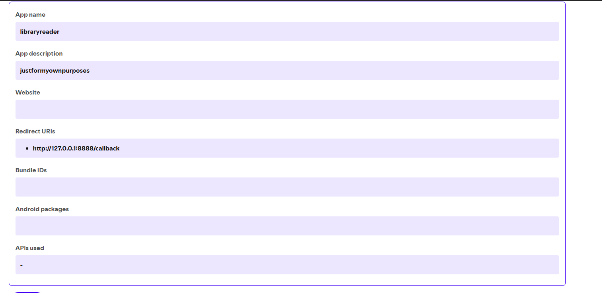

# spotify2csv

`spotify2csv` exports every track in your Spotify **Liked Songs** library to a
CSV file with `name`, `artist`, and `album` columns. It uses Spotify's official
Web API and asks only for permission to read your saved library.

It opens with a dependency-free ASCII interface containing the project links
and GrimSythe design credit. Use `--no-banner` when calling it from a script.

The export is UTF-8 with a byte-order mark, so names with accents and other
non-ASCII characters open cleanly in Excel as well as standard CSV tools.

## Requirements

- Python 3.9 or newer
- A Spotify account with access to the Web API
- A free app created in the [Spotify Developer Dashboard](https://developer.spotify.com/dashboard)

## Quick start

### Windows: double-click launcher

First, double-click **`Setup Spotify2CSV.bat`**. It opens the Spotify Developer
Dashboard, shows the required redirect URI, and saves your Client ID locally.
Then double-click **`Run Spotify2CSV.bat`** to export your library.

On its first run, the launcher creates the local Python environment and
installs the required packages. It also repairs the installation automatically
if the project folder is moved. The window remains open so you can read the
result or any error message.

You still need to complete the Spotify app configuration in step 1 below.

### 1. Get your Spotify Client ID — step by step

The Client ID comes from a free Spotify developer app. It is not your Spotify
username, account ID, password, or Client Secret.

1. Go to the [Spotify Developer Dashboard](https://developer.spotify.com/dashboard).
2. Select **Log in** and sign in with the Spotify account whose Liked Songs you
   want to export.
3. If Spotify presents updated developer terms, review and accept them before
   continuing.
4. Select **Create app**.
5. Enter an app name such as `Spotify2CSV`.
6. Enter a short description such as `Exports my Liked Songs to a CSV file`.
7. In **Redirect URI**, enter this exact address:

   ```text
   http://127.0.0.1:8888/callback
   ```

8. If Spotify asks which APIs or SDKs the app will use, select **Web API**.
9. Read and accept Spotify's Developer Terms, then select **Save** or
   **Create**.
10. Open the new app from the dashboard. The app overview or **Settings** page
    displays its **Client ID**.
11. Copy the **Client ID**. Do not select **View client secret**, and never paste
    a Client Secret into Spotify2CSV.
12. Double-click **`Setup Spotify2CSV.bat`**, paste the Client ID when prompted,
    and press Enter. The tool saves it locally for future runs.

Already have a Spotify developer app? Open it from the dashboard, select
**Settings**, confirm the redirect URI above is listed, save any changes, and
copy the Client ID from the app page.

Spotify requires the registered redirect URI and the URI used by this tool to
match exactly. Include `http://`, port `8888`, and `/callback`, and use
`127.0.0.1` rather than `localhost`.

`spotify2csv` uses Authorization Code with PKCE, so it does not need or store a
Client Secret.

#### Example app settings

Your finished app settings should look similar to this example:



The app name and description are your choice. Website, Bundle IDs, and Android
packages can remain blank for this desktop tool. The important setting is that
**Redirect URIs** contains exactly `http://127.0.0.1:8888/callback`. The
**APIs used** summary may look different depending on the current Dashboard
version; select **Web API** when Spotify presents that choice during creation.

### 2. Install spotify2csv

Open a terminal in this folder and create an isolated environment.

Windows PowerShell:

```powershell
py -m venv .venv
.venv\Scripts\Activate.ps1
py -m pip install --upgrade pip
py -m pip install -e .
```

macOS or Linux:

```bash
python3 -m venv .venv
source .venv/bin/activate
python3 -m pip install --upgrade pip
python3 -m pip install -e .
```

### 3. Set your Client ID

PowerShell:

```powershell
$env:SPOTIPY_CLIENT_ID = "your_client_id_here"
```

Command Prompt:

```bat
set SPOTIPY_CLIENT_ID=your_client_id_here
```

macOS or Linux:

```bash
export SPOTIPY_CLIENT_ID="your_client_id_here"
```

This setting lasts for the current terminal session. You can also pass the
Client ID for one run with `--client-id`. When running interactively, the tool
will prompt for the Client ID if neither option was provided.

### 4. Export your library

```text
spotify2csv
```

Your browser will open the first time so you can approve read-only access. The
tool then writes `liked_songs.csv` in the current directory. Future runs reuse
the local `.spotify_cache-pkce` authorization file until you revoke access or
remove that file.

## Usage

```text
usage: spotify2csv [-h] [-o OUTPUT] [--client-id CLIENT_ID]
                   [--redirect-uri REDIRECT_URI] [--cache CACHE]
                   [--setup] [--no-browser] [--no-banner] [--version]
```

Choose another output file:

```text
spotify2csv --output exports/my-liked-songs.csv
```

Run on a machine where a browser cannot open automatically:

```text
spotify2csv --no-browser
```

The tool will print an authorization URL for you to open manually.

Run the setup assistant again:

```text
spotify2csv --setup
```

Hide the ASCII interface for automation or redirected logs:

```text
spotify2csv --no-banner
```

You can also run the package or the legacy script directly:

```text
python -m spotify2csv
python export_liked_songs.py
```

Run `spotify2csv --help` for every option.

## Output

The CSV contains one row per available saved track:

```csv
name,artist,album
Song Title,"Artist One, Artist Two",Album Title
```

If an unavailable or removed track has no track data, the tool skips it. An
existing output file is replaced only after the full export has been fetched
and written successfully.

## Privacy and security

- The app requests only Spotify's `user-library-read` permission.
- Authentication uses Authorization Code with PKCE; no Client Secret is needed.
- `.spotify_cache-pkce` contains reusable account tokens. Do not share or
  commit it.
- `.spotify2csv.json` contains the app's public Client ID. It stays local and
  is ignored by Git; the tool never asks for or stores a Client Secret.
- Exported CSV files reveal your music library. They are ignored by Git by
  default, but you should review them before sharing.
- To disconnect the tool, remove its access in your Spotify account's app
  permissions and delete `.spotify_cache-pkce`.

Never publish a Client Secret or an existing token cache. If either has already
been shared, rotate the secret in the Developer Dashboard and revoke the app's
access before continuing.

## Why each user needs a Client ID

A Client ID identifies a Spotify developer app, not a normal Spotify profile.
Spotify does not provide an API for this tool to discover another person's
developer Client ID. Each user must create or open an app in their own Developer
Dashboard and copy the ID, which `Setup Spotify2CSV.bat` makes easier.

Sharing one development-mode Client ID is not a general public-distribution
solution: Spotify currently limits those apps to five allowlisted users, and
the app owner must have Premium. See Spotify's
[quota-mode documentation](https://developer.spotify.com/documentation/web-api/concepts/quota-modes).

## Troubleshooting

### `set SPOTIPY_CLIENT_ID or pass --client-id`

Set the environment variable in the same terminal where you run the command,
or use `spotify2csv --client-id YOUR_ID`.

### `INVALID_CLIENT: Invalid redirect URI`

Confirm that the Spotify app has
`http://127.0.0.1:8888/callback` registered exactly, including the port and
`/callback` path.

### PowerShell blocks `Activate.ps1`

You can skip activation and call the environment's Python directly:

```powershell
.venv\Scripts\python.exe -m pip install -e .
$env:SPOTIPY_CLIENT_ID = "your_client_id_here"
.venv\Scripts\python.exe -m spotify2csv
```

### Start authentication over

Delete `.spotify_cache-pkce` and run the command again. Treat that cache as a
credential; do not send it to anyone while troubleshooting.

## Development

Install the test dependency and run the tests:

```text
python -m pip install -e ".[dev]"
python -m pytest
```

This project was created by GrimSythe and is not affiliated with Spotify.
Spotify is a trademark of Spotify AB.

- Project: [github.com/GrimSythe/spotify2csv](https://github.com/GrimSythe/spotify2csv)
- Creator: [github.com/GrimSythe](https://github.com/GrimSythe)
